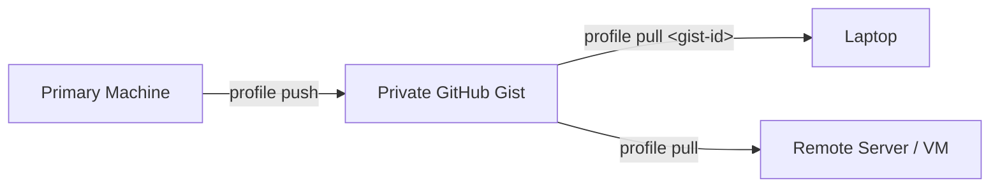

# Profile Workflow Guide

`bluefin-cli` provides portable profile management. You can capture your shell
configuration, tool selections, and theme flavor into a portable JSON document
and replay it across machines.

Profiles answer a common need: make this machine feel like my machine.

---

## 1. Profile Concepts

A profile captures reproducible user preferences for your CLI environment.

### What a profile contains

When you export a profile, `bluefin-cli` creates a JSON document with version `1`:

```json
{
  "version": 1,
  "flavor": "mocha",
  "tools": {
    "atuin": true,
    "bat": true,
    "carapace": false,
    "eza": true,
    "fzf": true,
    "glow": true,
    "starship": true,
    "ugrep": true,
    "uutils-coreutils": true,
    "uutils-diffutils": true,
    "uutils-findutils": true,
    "zoxide": true
  },
  "enabled_shells": [
    "bash",
    "fish",
    "zsh"
  ]
}
```

The document stores:

- `version`: Profile schema version (currently `1`).
- `flavor`: Theme flavor saved in `ui.flavor` (for example, `mocha`, `latte`, `macchiato`, `frappe`, `nord`, or `auto`).
- `tools`: A map of managed tool keys and their active status (`true` or `false`).
- `enabled_shells`: A list of shells that have `bluefin-cli` integration active.

### Immutability and safety guarantees

- **Declarative document**: A profile is plain JSON. You can inspect it, track it in Git, or edit it before application.
- **Reconciliation**: Applying a profile updates configuration values (`ui.flavor` in `~/.config/bluefin-cli/config.yaml` and shell tool configuration in `~/.config/bluefin-cli/shell.yaml`). It enables or disables rc-file integration lines for managed shells.
- **Non-destructive to custom rc lines**: `bluefin-cli` manages only its own block inside rc files. Custom aliases, functions, or external configs remain intact.
- **No secret storage**: Profiles do not contain passwords, API tokens, SSH keys, or private environment variables.

---

## 2. Export and Import Workflow

Local file-based export and import is the simplest workflow. It works offline and needs no GitHub account.

### Exporting your setup

To output JSON directly to your terminal:

```bash
bluefin-cli profile export
```

To save the profile to a file:

```bash
# Save using file argument
bluefin-cli profile export my-profile.json

# Or redirect standard output
bluefin-cli profile export > ~/backup-profile.json
```

### Checking drift with diff

Before applying a profile, inspect what would change:

```bash
bluefin-cli profile diff my-profile.json
```

If your machine matches the profile, `bluefin-cli` outputs:

```text
✓ No drift — this machine matches the profile.
```

If differences exist, `bluefin-cli` reports each change:

```text
Import would change:
  flavor: latte -> mocha
  tool atuin: off -> on
  shell fish: disabled -> enabled
```

For automation or CI scripts, add `--exit-code` to return non-zero when drift exists:

```bash
if ! bluefin-cli profile diff my-profile.json --exit-code; then
  echo "Configuration drift detected!"
fi
```

### Applying a profile

To apply the profile document:

```bash
bluefin-cli profile import my-profile.json
```

Output:

```text
flavor: mocha
tools: 12 configured
shell fish: true
✓ Profile applied.
```

---

## 3. Cloud Sync with GitHub Gist

`bluefin-cli profile push` and `bluefin-cli profile pull` synchronize your profile using a private GitHub Gist via the GitHub CLI (`gh`).

### Prerequisites

- Install `gh` (GitHub CLI).
- Authenticate with `gh auth login`.

### Pushing a profile

Run push on your primary machine:

```bash
bluefin-cli profile push
```

On first run:
1. `bluefin-cli` creates a new private gist titled `bluefin-cli profile` containing `bluefin-profile.json`.
2. It saves the gist ID into `~/.config/bluefin-cli/config.yaml` under the key `profile.gist_id`.
3. Output:

```text
✓ Profile pushed to new private gist 7a8b9c0d1e2f3a4b5c6d (saved in config)
```

On later runs on the same machine, `profile push` updates the existing gist:

```text
✓ Profile pushed to gist 7a8b9c0d1e2f3a4b5c6d
```

### Pulling a profile

On a new machine, pull using the gist ID:

```bash
bluefin-cli profile pull 7a8b9c0d1e2f3a4b5c6d
```

When you specify the gist ID:
1. `bluefin-cli` downloads `bluefin-profile.json` from GitHub.
2. It saves `profile.gist_id` into the local machine's config file.
3. It applies the theme, tool settings, and shell integrations immediately.

On subsequent updates on that machine, run pull without arguments:

```bash
bluefin-cli profile pull
```

---

## 4. Multi-Machine Setup

Use profiles to keep desktop workstations, laptops, and virtual machines synchronized.

### Setup flow



1. **Machine 1 (Source)**:
   ```bash
   bluefin-cli profile push
   # Note the reported gist ID: 7a8b9c0d1e2f3a4b5c6d
   ```
2. **Machine 2 (Target)**:
   ```bash
   bluefin-cli profile pull 7a8b9c0d1e2f3a4b5c6d
   ```
3. **Machine 3 (Target)**:
   ```bash
   bluefin-cli profile pull 7a8b9c0d1e2f3a4b5c6d
   ```

Now all machines share the gist ID in their local configuration.

---

## 5. Cross-Platform Profiles

`bluefin-cli` supports Linux, macOS, and Windows. Profiles can transfer across operating systems, with platform-specific behavior for shell reconciliation.

### What transfers cleanly

- **Theme flavor**: UI flavors apply identically across all platforms.
- **Tool selections**: Tool flags in `tools` are platform-independent configuration keys.
- **JSON format**: The schema is consistent across operating systems.

### What differs across platforms

| Feature | Linux / macOS / Unix | Windows / WSL |
|---|---|---|
| Reconciled shells | `bash`, `zsh`, `fish` | `powershell` |
| RC file mechanism | Edits `~/.bashrc`, `~/.zshrc`, `~/.config/fish/config.fish` | Edits `$PROFILE` (PowerShell profile script) |
| Binary packages | Managed by Homebrew or Alpine `coldbrew`/`apk` | Managed by Winget or Homebrew (WSL) |
| Tool availability | Most tools available on POSIX | Some tools (such as `ugrep` or `uutils-*`) skip PowerShell |

### Platform reconciliation rules

When `bluefin-cli profile import` or `pull` runs:
- On **Linux / macOS**: It reconciles Unix shells (`bash`, `zsh`, `fish`). If a shell is listed in `enabled_shells`, it enables it; if not listed, it disables it.
- On **Windows**: It reconciles `powershell`.
- Unmanaged shells present in the profile list for other platforms are safely ignored during target reconciliation.

---

## 6. Updating and Versioning

Profiles can change as your setup evolves.

### Local file versioning in Git

You can store profile files inside a dotfiles repository:

```bash
mkdir -p ~/dotfiles/bluefin
bluefin-cli profile export > ~/dotfiles/bluefin/profile.json

cd ~/dotfiles
git add bluefin/profile.json
git commit -m "feat(bluefin): update shell tools and theme"
git push
```

### Profile document versioning

`Profile.Version` in the JSON document is `1`. If future versions of `bluefin-cli` update the document schema, older versions will guard against incompatible schemas with an explicit error:

```text
unsupported profile version 2
```

---

## 7. Conflict Resolution

When you sync across multiple devices, divergence can happen if two machines update settings independently.

### Handling push and pull divergence

GitHub Gists do not support automatic branch merging. The last push overwrites the gist contents.

To avoid accidental overwrites:

1. **Before pushing from Machine B**:
   Check if the remote profile has changes by fetching or diffing first:
   ```bash
   # Download the current remote gist to a temporary file
   gh gist view $(bluefin-cli config get profile.gist_id 2>/dev/null || cat ~/.config/bluefin-cli/config.yaml | grep gist_id | awk '{print $2}') --filename bluefin-profile.json --raw > /tmp/remote-profile.json

   # Diff against your local state
   bluefin-cli profile diff /tmp/remote-profile.json
   ```

2. **If differences exist**:
   - If you want the remote settings, run `bluefin-cli profile pull`.
   - If you want your local settings to become the new source of truth, run `bluefin-cli profile push`.

---

## 8. Team and Organization Profiles

Teams can use standardized profiles to provision consistent developer workstations.

### Sharing team templates

1. Create a baseline template `team-profile.json`:
   ```json
   {
     "version": 1,
     "flavor": "mocha",
     "tools": {
       "bat": true,
       "eza": true,
       "fzf": true,
       "starship": true,
       "zoxide": true
     },
     "enabled_shells": [
       "bash",
       "zsh"
     ]
   }
   ```

2. Store `team-profile.json` in your team's developer onboarding repository or an internal wiki.

3. New team members apply the template during onboarding:
   ```bash
   curl -fsSL https://internal.example.com/profiles/team-profile.json -o /tmp/team-profile.json
   bluefin-cli profile import /tmp/team-profile.json
   ```

---

## 9. Troubleshooting

### Problem: `profile push` fails with "profile sync uses the GitHub CLI"

**Cause**: `gh` is not found on your system `PATH`.

**Solution**:
1. Install GitHub CLI:
   ```bash
   brew install gh       # macOS / Linux (Homebrew)
   winget install GitHub.cli  # Windows
   ```
2. Authenticate:
   ```bash
   gh auth login
   ```

### Problem: `profile pull` reports "no gist configured"

**Cause**: No gist ID was passed as an argument, and `profile.gist_id` is empty in `~/.config/bluefin-cli/config.yaml`.

**Solution**:
Pass the gist ID explicitly on the first pull:
```bash
bluefin-cli profile pull <gist-id>
```
Once pulled successfully, `bluefin-cli` saves the ID for future runs.

### Problem: Import succeeds, but tools do not execute

**Cause**: Profiles synchronize tool *configuration* (whether a tool is enabled in `bluefin-cli`'s shell hooks), not tool *binaries*.

**Solution**:
Install any missing binaries using `bluefin-cli`:
```bash
# Verify system status
bluefin-cli doctor

# Install missing CLI tools
bluefin-cli install cli
```

---

## 10. Example Workflows

### Example A: Quick backup before system reinstall

```bash
# 1. Export current profile
bluefin-cli profile export ~/profile-backup.json

# 2. Copy profile-backup.json to a USB drive or cloud drive

# 3. After clean OS installation, install bluefin-cli and apply:
bluefin-cli profile import /media/usb/profile-backup.json
```

### Example B: Syncing a work laptop with a home desktop

```bash
# On your home desktop:
bluefin-cli profile push
# Output: ✓ Profile pushed to new private gist 4a5b6c7d8e9f (saved in config)

# On your work laptop:
bluefin-cli profile pull 4a5b6c7d8e9f

# Both machines are now linked to gist 4a5b6c7d8e9f.
# Future updates on either machine require only:
bluefin-cli profile push   # on the machine with new settings
bluefin-cli profile pull   # on the other machine
```

### Example C: Audit configuration drift in CI / cron

Run `bluefin-cli profile diff` in a periodic maintenance script:

```bash
#!/usr/bin/env bash
set -euo pipefail

PROFILE_FILE="$HOME/.dotfiles/bluefin/profile.json"

if ! bluefin-cli profile diff "$PROFILE_FILE" --exit-code; then
  echo "Notice: System configuration drifted from $PROFILE_FILE"
  # Optional: Re-apply to enforce consistency
  # bluefin-cli profile import "$PROFILE_FILE"
fi
```
